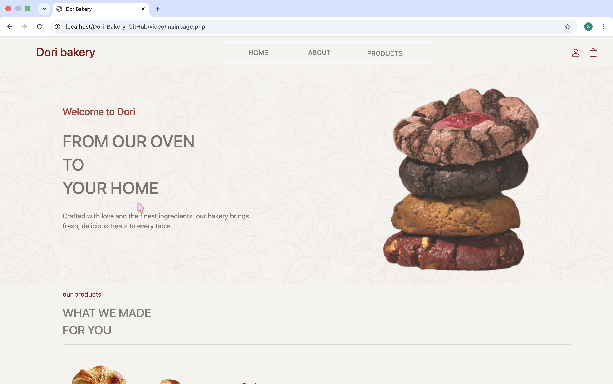
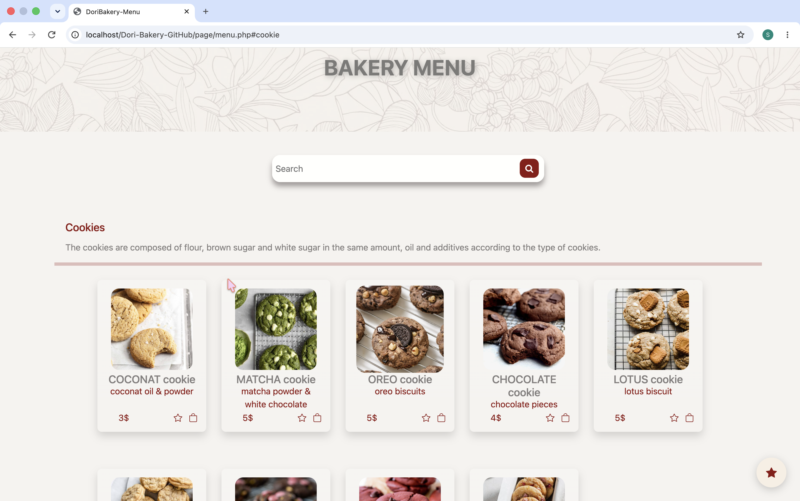
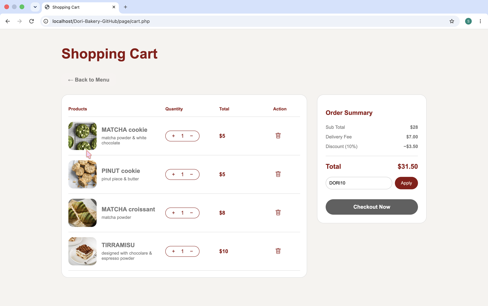
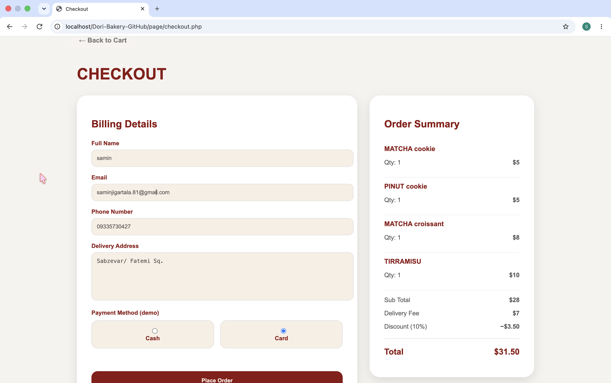
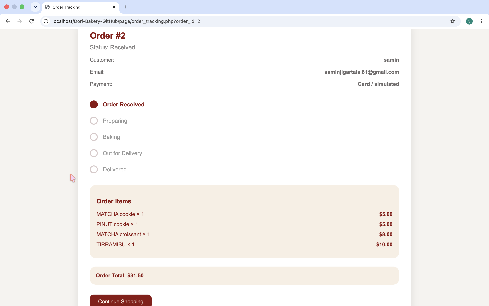
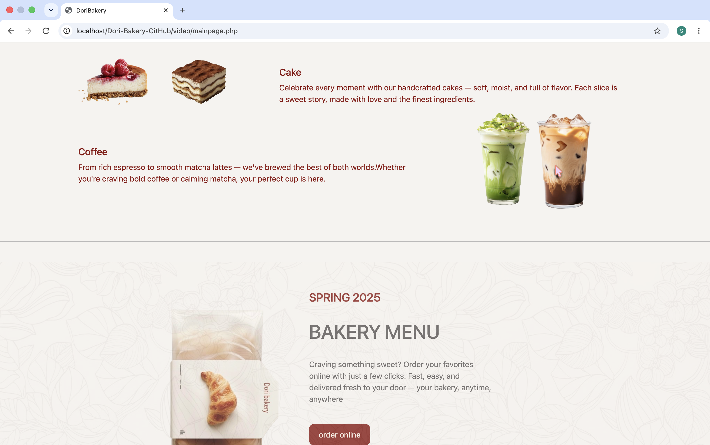
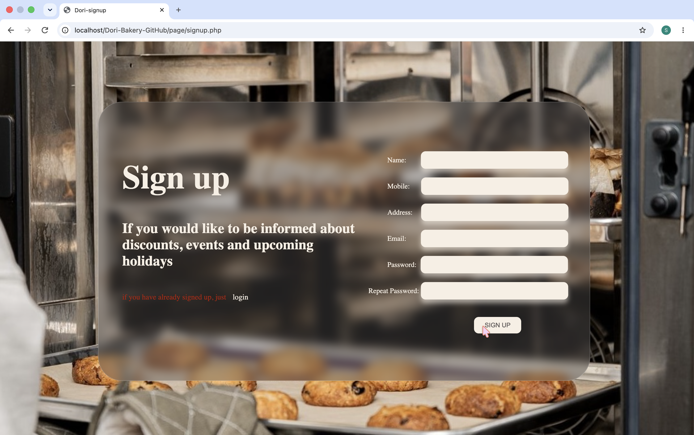

# Dori Bakery

Dori Bakery is a bakery storefront I built during my bachelor’s degree in Computer Engineering. It uses PHP, MariaDB/MySQL, HTML, CSS, JavaScript, and Bootstrap. This portfolio copy keeps the original page layouts, branding, product photography, and bakery video, with fixes to the account and ordering flows.

The menu has cookies, croissants, and cakes, with search by name or description. A signed-in customer can save favorites, change cart quantities, apply the demo code `DORI10`, and place and track a demo order. Checkout simulates Cash or Card and collects no card details. Coffee appears on the homepage, and the menu marks it as unavailable for online ordering.

## Run with XAMPP on macOS

1. Copy this folder into `/Applications/XAMPP/xamppfiles/htdocs/` so the folder inside `htdocs` is named `Dori-Bakery-GitHub`. Copy hidden files too, including `.htaccess`. Start Apache and MySQL in XAMPP Manager.
2. Open [local phpMyAdmin](http://localhost/phpmyadmin/). Create two **empty** databases named `dori_login` and `dori_search_menu`, using `utf8mb4_general_ci` as the default collation. The new names let the portfolio copy run alongside the original databases.
3. Select `dori_login`, open **Import**, select `database/login.sql`, and run the import. Select `dori_search_menu` and repeat with `database/search_menu.sql`. The login file contains tables only. The menu file seeds the catalog and creates empty shopping and order tables.
4. In phpMyAdmin’s **User accounts** tab, create a local database user with a password and grant it `SELECT`, `INSERT`, `UPDATE`, and `DELETE` on these two databases only. The example connects over TCP to `127.0.0.1` on port `3306`. Use a database account allowed to connect from that host. Use phpMyAdmin’s admin account to import the schemas.
5. Copy `config.example.php` to `config.local.php`. Set the connection details and database names there. The private copy is ignored by Git. Apache needs PHP 8.2 or newer with `mysqli` (mysqlnd) and `mbstring`.
6. Open [Dori Bakery on localhost](http://localhost/Dori-Bakery-GitHub/). Create a demo account and place a sample order with fictional contact details.

The SQL files are intended for fresh databases. If either name already exists, create a different empty database and use its name in `config.local.php`.

## Optional local hostname

Copy the block in [the virtual host example](setup/dori-bakery-vhost.conf) into XAMPP’s `/Applications/XAMPP/xamppfiles/etc/extra/httpd-vhosts.conf`. Update the two project paths if needed. In `/Applications/XAMPP/xamppfiles/etc/httpd.conf`, enable the `Include etc/extra/httpd-vhosts.conf` line. Review any stock sample virtual hosts in that file and keep a `localhost` virtual host pointing at the normal XAMPP document root if you also use other local sites. Check the configuration with `/Applications/XAMPP/xamppfiles/bin/httpd -t`, restart Apache, and open [dori-bakery.localhost](http://dori-bakery.localhost/).

The `.localhost` name is reserved for loopback and needs no public DNS. If your browser or local resolver cannot resolve it, add `127.0.0.1 dori-bakery.localhost` to `/etc/hosts`. [Apache virtual hosts](https://httpd.apache.org/docs/2.4/vhosts/name-based.html) · [RFC 6761, section 6.3](https://www.rfc-editor.org/rfc/rfc6761.html#section-6.3)

## Project layout

| Path | Contents |
| --- | --- |
| `index.php` | Redirect to the original homepage |
| `video/` | Homepage and original videos |
| `page/` | Menu, accounts, cart, favorites, checkout, and tracking |
| `css/`, `js/`, `image2/`, `font/` | Frontend styles, scripts, artwork, and fonts |
| `database/` | Two SQL imports |
| `setup/` | Optional Apache virtual host example |

## Security and testing

Database queries bind parameters. Accounts use hashed passwords, and sign-in regenerates the session ID. POST forms and menu actions use CSRF tokens. The server checks ownership, prices, quantities, and discounts and saves the order and cart changes together.

The [preparation report](PREPARATION_REPORT.md) lists the checks performed and the remaining limitations. The tracking page displays the order’s stored status. Orders start at **Received** and the demo has no staff interface to advance them. Icon styles still use the original external CDNs. Some homepage and menu sections keep their original desktop-oriented spacing.

## Known Limitations

* The website was developed and tested locally using XAMPP.
* Some layout elements, including navigation icons and images, may not display or align correctly in Safari when the browser window is resized or not maximized.
* The layout appears to work as expected in Google Chrome during local testing.
* Checkout is simulated; no real payments are processed.

## Screenshots

### Homepage

### Product Menu

### Shopping Cart

### Checkout

### Order Tracking

### Homepage Sections

### Sign Up

